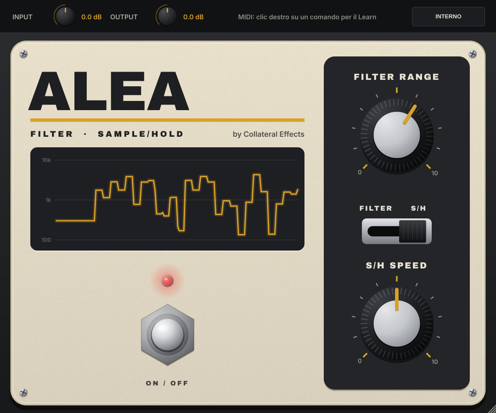

# Collateral Effects ALEA — emulazione circuitale del filtro Sample/Hold anni '70 (VST3 / AU / Standalone)

Plugin in C++17 con JUCE 8. Riferimento: lo schema del Maestro FSH-1 Filter Sample/Hold ridisegnato da
JD Sleep (revisione 2001/05/14), con le foto del circuito stampato e dell'interno del pedale.
La grafica del frontale è originale Collateral Effects; disposizione e funzione dei comandi
sono quelle del pedale.

## Comandi

| Comando | Componente | CC predefinito |
|---|---|---|
| FILTER RANGE | R15 100k (log) | 20 |
| S/H SPEED | R28 2M (log) + R29 | 21 |
| Deviatore FILTER / S/H | SW1 | 22 (commuta alla pressione) |
| Footswitch (effetto on/off) | SW2 | 64 (pedale sustain) |
| INPUT / OUTPUT (barra superiore) | — | — |
| LIMIT (barra superiore) | — | — |

- **FILTER**: un inviluppo (IC3, raddrizzatore di precisione, carica su C6 in ~15 ms, rilascio
  ~0,1–0,5 s) apre il filtro passa-banda mentre suoni. FILTER RANGE è la sensibilità: a zero il
  filtro resta fermo, al massimo si apre fino a oltre 10 kHz.
- **S/H**: il rumore del transistor Q4, amplificato da IC4, viene campionato da Q5 e tenuto su C9
  a ogni impulso del clock IC5 (da 1,7 a 12 Hz con S/H SPEED): il filtro salta a frequenze casuali.
  Come sull'originale, **in S/H la manopola FILTER RANGE non ha effetto**.
- Il filtro è un passa-banda a variabili di stato con due CA3080: **Q ≈ 10** e **+20 dB** al
  centro, frequenza proporzionale alla corrente di Q3 (da ~140 Hz a oltre 10 kHz). Le OTA sono
  modellate con la loro caratteristica tanh: suonando forte sulla risonanza il filtro si "sporca"
  come il circuito reale.
- Il LED (aggiunto nel plugin) è acceso con l'effetto inserito e lampeggia a ogni campione in S/H.
  La finestra sul frontale mostra la frequenza del filtro negli ultimi 4 secondi.

Il pedale è mono: il plugin prende la chitarra da qualunque ingresso arrivi e copia l'uscita
su tutti i canali. 0 dBFS in ingresso = 1 V di picco al jack del pedale; INPUT parte da
+10,8 dB, la taratura per una chitarra collegata direttamente all'ingresso di una scheda audio.

**LIMIT** (attivo di partenza) è un limitatore di picco a latenza zero sull'uscita: tiene il segnale
sotto −1 dBFS. Il passa-banda ha +20 dB di risonanza e una nota che cade sul centro del filtro
può superare 0 dBFS: il pedale vero satura solo verso 7 V, ma in digitale quei picchi verrebbero
tagliati dalla scheda audio con un suono "da cono rotto". La saturazione del circuito resta modellata.

## Interno (pulsante INTERNO)

I trimmer del circuito stampato, utili solo in modalità S/H:

- **S/H OFFSET (R26 100k)**: polarizzazione di Q3, sposta tutti i gradini in alto o in basso.
- **S/H LEVEL (R27 10k)**: quanto rumore arriva a Q5, cioè l'ampiezza dei salti. Alto e con
  OFFSET basso, molti gradini finiscono sul minimo (~140 Hz) come su un esemplare starato.
- **RUMORE Q4**: lo schema dice "Q4 selected for noise": il rumore a valanga cambia da un
  transistor all'altro.

"VALORI DI FABBRICA" (o doppio clic sul trimmer) riporta la taratura predefinita.

Nella seconda fila:

- **ESEMPLARE**: numero di serie del "tuo" pedale. Ogni esemplare dell'epoca aveva componenti
  con tolleranze diverse (resistenze 10 %, condensatori 10–20 %, i due CA3080 con transconduttanze
  diverse fra loro, JFET con soglie diverse): cambiano di poco frequenza, risonanza, risposta
  dell'inviluppo, velocità del clock e centro del S/H. 0 = valori nominali dello schema;
  "A CASO" pesca un esemplare. Lo stesso numero dà sempre lo stesso pedale.
- **CARICO PICKUP**: per una chitarra con pickup passivi registrata in DI (ingresso da 1 MΩ).
  L'ingresso del pedale (R2 100k in parallelo a Q1, ~97 kΩ) carica il pickup e ne smorza la
  risonanza: il suono si scurisce, anche a effetto escluso, come collegando la chitarra al pedale.

## MIDI (Arturia KeyLab)

**MIDI Learn**: clic destro su un comando → *MIDI Learn* → muovi un controllo della KeyLab.
La mappatura è salvata nel progetto. Deviatore e footswitch commutano alla pressione: imposta i
pulsanti in modalità *Gate/Momentary* in Arturia MIDI Control Center.

In Ableton Live un effetto audio non riceve MIDI da solo: o usi la mappatura MIDI di Live
(Configura → muovi il comando del plugin → Cmd+M), oppure crei una traccia MIDI con ingresso
KeyLab, Monitor su **In** e, in "MIDI To", la traccia della chitarra e poi "ALEA". Dalla 1.3.1
l'AU è registrato come effetto controllabile via MIDI (`aumf`): prima Live non lo proponeva come
destinazione. Dopo l'aggiornamento, nei set già salvati va reinserita la versione AU.
La Standalone riceve la KeyLab direttamente.

## Compilazione

GitHub Actions compila a ogni push su `main` (`.github/workflows/build-macos.yml`) e produce
`ALEA-macOS.zip` (universal binary, firma ad-hoc) con VST3, AU, Standalone e
`Installa ALEA.command`, che copia i plugin in `/Library/Audio/Plug-Ins` e toglie la quarantena.
Con un tag `v1.0.0` lo zip viene pubblicato anche come release.

In locale: `cmake -B build && cmake --build build --config Release` (scarica JUCE 8.0.4).
`build/circuit_test` verifica il modello: frequenza centrale e Q del filtro, frequenza del
clock, apertura dell'inviluppo, distribuzione dei gradini S/H, stabilità a 44,1–192 kHz.

## Note sul modello

- Il filtro gira a 176–192 kHz (sovracampionamento 4x a 44,1/48 kHz, 2x a 88,2/96 kHz);
  inviluppo, clock, rumore, S/H e Q3 girano alla frequenza base, con la corrente Iabc
  interpolata fra un aggiornamento e l'altro. Le costanti di tempo sono discretizzate in forma
  esatta e i coefficienti si ricalcolano solo quando cambia un comando.
- Filtro: integrazione trapezoidale con soluzione di Newton delle due OTA; con il predittore
  lineare basta una correzione per campione (errore sotto −138 dB rispetto alla soluzione esatta).
- Q2 è un inseguitore con guadagno 0,94; R6 e R13 alimentano separatamente i due 3080.
- Dalla 1.3, correnti di base dei CA3080 (β ≈ 125, cioè 2 µA a Iabc 500 µA e 26 kΩ d'ingresso,
  come da datasheet): escono da C5 e attraversano le resistenze di polarizzazione (R4//R5//R7,
  R9//R10 e R12, che sul pin 3 di IC2 le compensa). Sono risolte in modo implicito nel Newton.
  Effetto: Q dal 3 al 6 % più basso, frequenza che sale un po' meno che in proporzione a Iabc
  (−3,5 % in cima alla gamma), una seconda armonica attorno a −70 dB.
- Escursione asimmetrica della tensione su C3: in alto la limita la saturazione di Q2, in basso
  l'uscita del 3080 (circa 1,4 V e 0,5 V dai binari ±8 V), attorno al punto di lavoro −Vgs di Q2.
- Q6 in S/H è caricato anche da R22 verso l'emettitore di Q3: i gradini più alti si comprimono un po'.
- Correzione della deformazione di frequenza dell'integrazione trapezoidale (tan(x)/x alla
  frequenza centrale, aggiornata alla frequenza base): il picco cade alla frequenza analogica.
- Il test confronta le novità della 1.3 con il modello della 1.2 (`setLegacyModel`); la soluzione
  a passo singolo degli ingressi dei 3080 resta entro −120 dB da quella esatta.
- A effetto escluso il filtro audio non viene calcolato (la parte di controllo sì, come nel pedale).
- Dalla 1.1 il modello è circa 3 volte più veloce della 1.0; il test `circuit_test` confronta
  il suono con il modello 1.0 (`tests/FSHCircuitRef.h`): a regime la differenza è sotto −110 dB.
- Q3 è risolto con la legge esponenziale del diodo base-emettitore; C7/R20 sul collettore
  ammorbidiscono i gradini (~1,6 ms) e fissano la corrente minima.
- Q6 (2N4303) inseguitore con legge quadratica del JFET; Q5 conduce anche parzialmente durante
  la tenuta se il rumore scende sotto la soglia di pinch-off, come nel circuito reale.

Uso personale e non commerciale. Font: Archivo Black (OFL), Inter (OFL).
